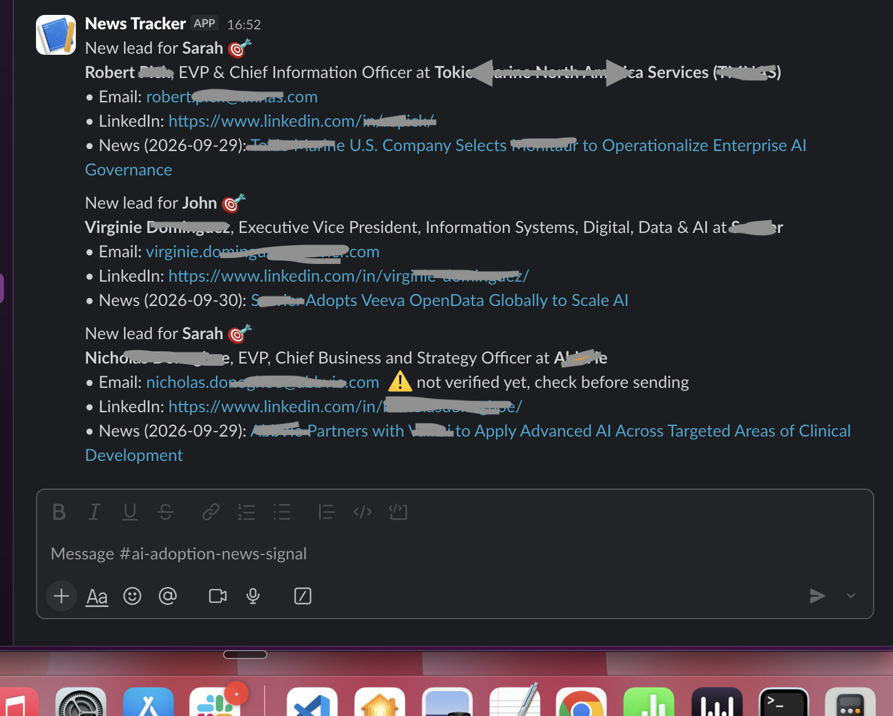

# AI Adoption News Tracker

Catches companies the moment they announce they are adopting AI, and puts the right decision maker in front of an SDR while the news is still fresh.

## Why it was built

This tracker was built for an AI governance company. A company only needs AI governance once it is actually using AI, so the strongest buying signal is simple: **this company just announced it is adopting AI.**

Those announcements are scattered across press wires and news sites, and they go stale fast. Found by hand, the moment has usually passed before a rep reaches the right person.

## What it solves

This tracker turns that signal into a lead an SDR can act on the same day:

- **No missed announcements.** It watches the news sources and picks up every new AI adoption story.
- **No noise.** Only real "company X is adopting AI" stories get through. Vendor launches, funding news, surveys and promos are dropped, so reps are not chasing companies with no need for AI governance yet.
- **No research time.** Each lead arrives with the current decision maker, a verified email and their LinkedIn.
- **No dropped or duplicated leads.** Leads are handed out to SDRs in turn in Slack, so every one has an owner and the load is shared fairly.

The result is outreach that lands with a reason to talk right now: the prospect just announced the exact thing the product exists to govern.

## How it works

1. **Fetch** – `fetch_news.py` pulls the last 14 days of headlines from press wires and news sites (`config.json`).
2. **Filter** – real "company X adopts AI" stories are kept; vendor launches, funding, surveys and promos are dropped.
3. **Enrich** – the current decision maker is found and checked, then `email_waterfall.sh` finds and verifies their email through Clay.
4. **Route** – `route_leads.py` posts each lead to Slack, taking turns between SDRs (`sdrs.json`). The rotation carries over day to day.

## Sample Slack post



## Setup

```bash
python3 -m venv .venv && .venv/bin/pip install feedparser
cp .env.example .env   # add your Slack webhook
```

Requires the `clay` CLI (logged in) for email lookups.

## Run

```bash
.venv/bin/python fetch_news.py --days 14
.venv/bin/python route_leads.py --dry-run   # preview
.venv/bin/python route_leads.py             # post to Slack
```

## How it all connects


